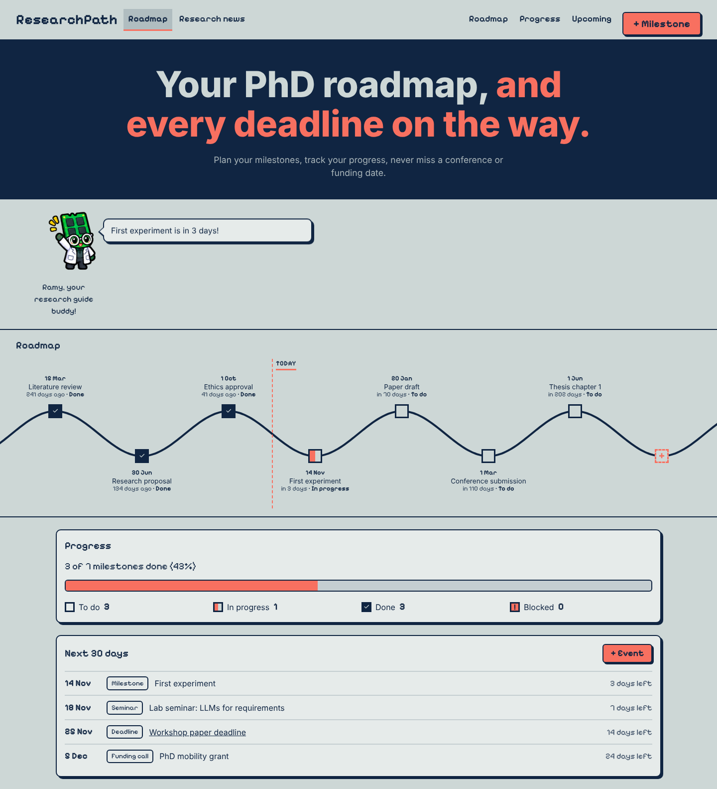
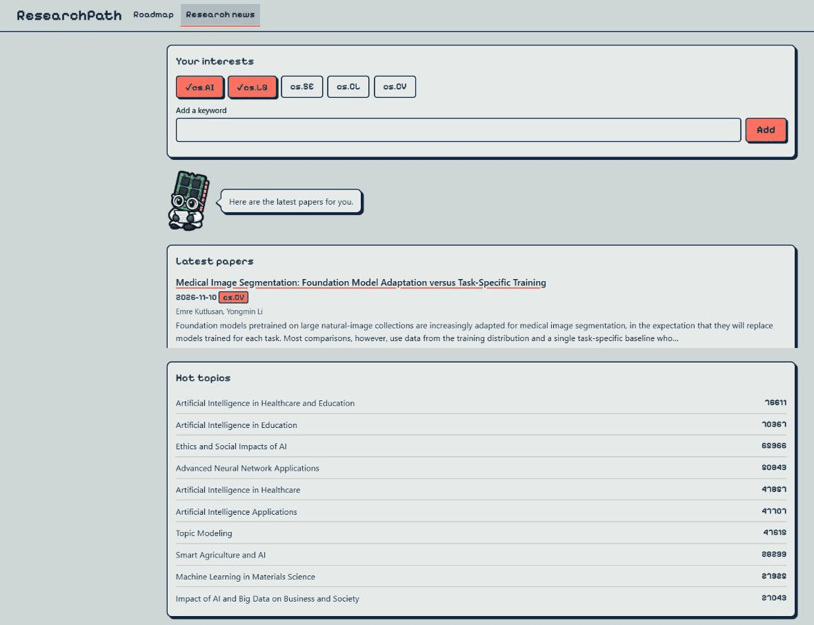
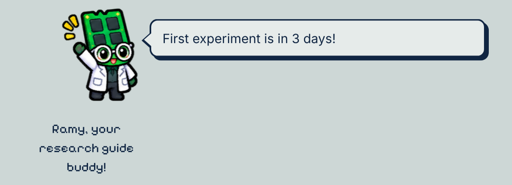
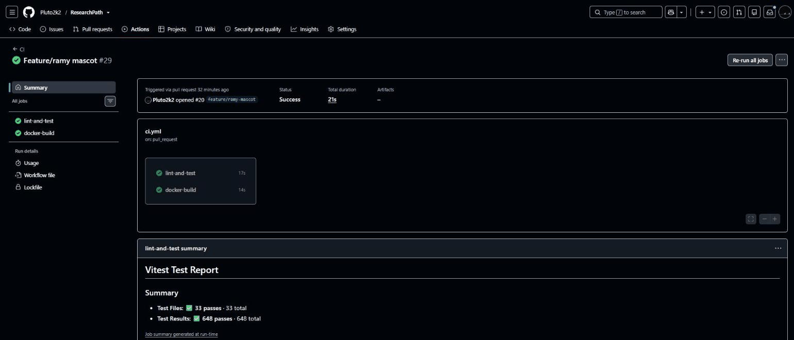
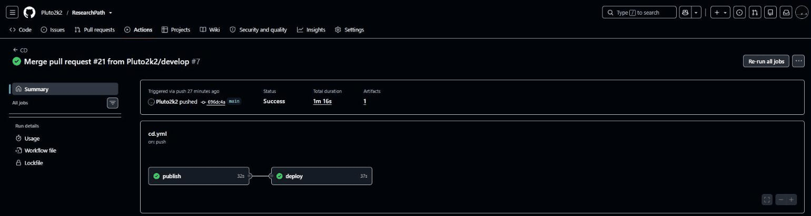
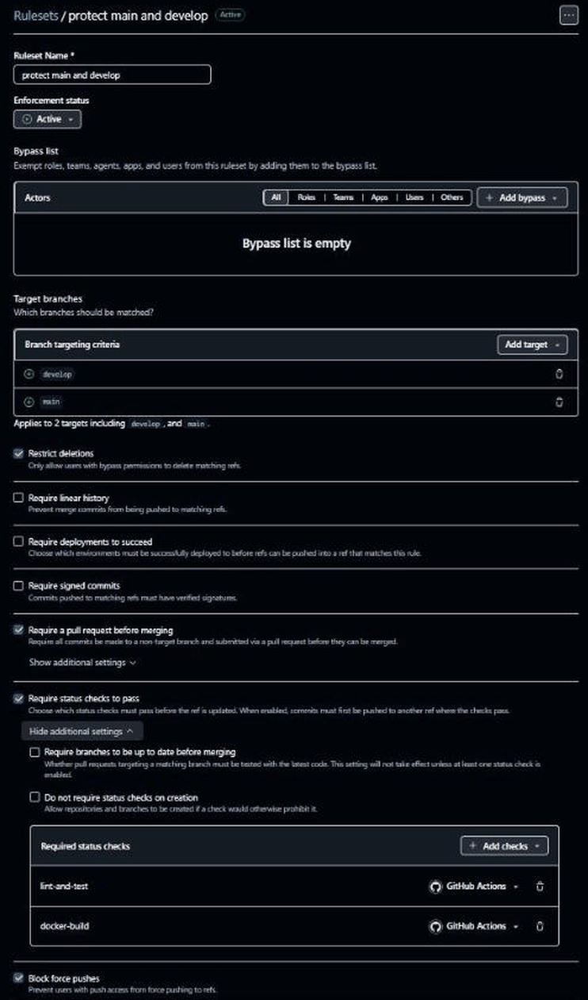

# ResearchPath

An interactive research roadmap for PhD students: your milestones, your progress, and
everything due in the next 30 days, in one place.

> **Status:** v0.3.0 released (M11, Ramy). Milestones, status and progress, the next 30 days (v0.1.0), the research news tab (v0.2.0, M09) and Ramy, your research guide buddy (v0.3.0, M11) are live. Live demo: https://researchpath.onrender.com. See [Status and next steps](#status-and-next-steps).



## What it is

A PhD student juggles a multi-year plan (literature review, experiments, papers) and a stream of
outside dates (conference deadlines, seminars, funding calls). The plan lives in their head, a
spreadsheet and their inbox, so they lose sight of where they stand and miss deadlines.

ResearchPath is a small web app for PhD students in their first years. It shows:

- their **research roadmap**: milestones on a timeline, in date order;
- their **overall progress**: the status of each milestone and how much is done;
- **the next 30 days**: milestones plus the conferences, seminars, submission deadlines and funding calls they add;
- **research news** (v0.2.0): in a second tab, the latest arXiv papers and the hot OpenAlex topics for the interests they choose.

So they see where they stand and never miss a date. It is built for one person on their own
laptop or phone; accounts come later.

## Features

| Story | Status | Mission | PR | Release |
|---|---|---|---|---|
| **US-01** As a PhD student, I want to build my research roadmap with milestones (title, target date, notes), so that I see my whole path at a glance. | Delivered | [M04](docs/missions/M04-roadmap-milestones.md), [M04b](docs/missions/M04b-ui-polish.md) | [#5](https://github.com/Pluto2k2/ResearchPath/pull/5), [#6](https://github.com/Pluto2k2/ResearchPath/pull/6) (to `main`), [#7](https://github.com/Pluto2k2/ResearchPath/pull/7) (to `develop`) | [v0.1.0](https://github.com/Pluto2k2/ResearchPath/releases/tag/v0.1.0) |
| **US-02** As a PhD student, I want to update each milestone's status (to do, in progress, done, blocked) and see my overall progress, so that my roadmap shows where I really stand. | Delivered | [M05](docs/missions/M05-milestone-status-progress.md) | [#8](https://github.com/Pluto2k2/ResearchPath/pull/8) | [v0.1.0](https://github.com/Pluto2k2/ResearchPath/releases/tag/v0.1.0) |
| **US-03** As a PhD student, I want to add conferences, seminars, submission deadlines and funding calls, and see everything due in the next 30 days with my milestones, so that I never miss a date. | Delivered | [M06](docs/missions/M06-events-next-30-days.md) | [#9](https://github.com/Pluto2k2/ResearchPath/pull/9) | [v0.1.0](https://github.com/Pluto2k2/ResearchPath/releases/tag/v0.1.0) |
| **US-04** As a PhD student, I want a daily digest of new papers on my topics (from arXiv / OpenAlex), so that I keep up with my field without searching every day. *(delivered as an on-demand tab, not a daily digest)* | Delivered | [M09](docs/missions/M09-research-news.md) | [#13](https://github.com/Pluto2k2/ResearchPath/pull/13) | [v0.2.0](https://github.com/Pluto2k2/ResearchPath/releases/tag/v0.2.0) |
| **US-05** As a PhD student, I want a board of events and opportunities (funding, positions, visibility) picked by my interests, so that I find chances I would otherwise miss. | Next | — | — | planned v0.2 |
| **US-06** As a PhD student, I want to share a paper draft with peers I invite and be notified when they leave feedback, so that I get feedback in days, not weeks. | Next (needs accounts) | — | — | planned later |
| **US-07** As a PhD student, I want my own account, so that my roadmap is private and available on any device. | Next | — | — | planned later |

**Status and progress (US-02, M05):** each milestone has a status (`todo`, `doing`, `done`, `blocked`),
set from the milestone's detail popover on the roadmap. Each node shows its status shape and name,
and the Progress section shows "X of Y milestones done (Z%)" with the count per status.

- `PATCH /api/milestones/:id/status` with `{ "status": "<value>" }` returns the updated milestone. An unknown status returns `400`, an unknown or non-numeric id returns `404`.
- `GET /api/progress` returns `{ total, done, percent, byStatus }`; `percent` is `done / total * 100`, rounded, and `0` with no milestones.

**Events and next 30 days (US-03, M06):** the Upcoming section lists the milestones not `done` dated from today to today + 30 days, and the events dated from today to today + 30 days, earliest first. Milestones not `done` that are overdue come first and are flagged. Events are added from the "+ Event" form in that card: a type (`conference`, `seminar`, `deadline` or `funding`), a date, and optionally a link and notes.

- `POST /api/events` with `{ "title", "type", "date", "url"?, "notes"? }` returns `201` with the created event. Invalid input returns `400` with a message naming the field; a `url` must start with `http://` or `https://`.
- `GET /api/events` returns all events, earliest date first.
- `GET /api/upcoming` returns the milestones not `done` dated from today to today + 30 days, the overdue milestones not `done` (listed first, `overdue: true`), and the events dated from today to today + 30 days (both ends included). Each item has `kind`, `daysLeft` and `overdue`. "Today" is the UTC date of the server clock.

**Research news (US-04, M09, v0.2.0):** a second tab, "Research news" (`#/news`), where the student
picks arXiv categories (`cs.AI`, `cs.LG`, `cs.SE`, `cs.CL`, `cs.CV`) and up to 5 keywords. Interests
are saved in the browser (`localStorage`). The tab shows the latest arXiv papers and the hot topics
from OpenAlex for the last 365 days. It is on demand, not a daily digest.

- `GET /api/news/papers?categories=cs.AI,cs.LG&q=keyword` returns up to 20 papers from the arXiv API, newest first. Requests to arXiv are spaced at least 3 seconds apart.
- `GET /api/news/topics?categories=...&q=...` returns the top 10 OpenAlex topics with their counts.
- At least one of `categories` or `q` is required. Both endpoints are cached on the server for 30 minutes. When an upstream API fails or times out, the endpoint returns `502` with a message.



**Ramy, your research guide buddy (M11, release v0.3.0):** a mascot standing above the roadmap, with a floating speech bubble.
His speech bubble says the most useful thing right now: an overdue milestone, a deadline within 7 days, a progress
step (25, 50, 75 or 100 %), or a tip. Clicking Ramy shows the next message. He reacts to a finished milestone, to an
empty next-30-days list, and to the Research news tab (loading, errors, hot topics unavailable). Mission:
[M11](docs/missions/M11-ramy-mascot.md). PR: [#20](https://github.com/Pluto2k2/ResearchPath/pull/20).



Full scope: [`docs/mvp-scope.md`](docs/mvp-scope.md).

## How to run it

**Stack:** Node.js 22, Express 5, SQLite (`node:sqlite`), plain HTML/CSS/JS, Vitest + Supertest, ESLint.

**Live demo:** https://researchpath.onrender.com. It runs on Render's free plan: it spins down when
idle, so the first request can take a while, and its data is not persistent (see [Deployment](#deployment)).

**In the DevContainer (recommended):** open the folder in VS Code and choose
"Reopen in Container". The container uses the `javascript-node:22` image, installs the ESLint
extension, forwards port 3000 and runs `npm install` when it is created. Then:

```bash
npm run dev            # http://localhost:3000, restarts on file changes
npm start              # production-like run, no file watching
npm test               # Vitest + Supertest
npm run lint           # ESLint
```

**Settings from `.env`:** `npm run dev`, `npm start` and `docker compose` read a `.env` file in the
project root when it exists, and start with the defaults when it does not. Create it from
[`.env.example`](.env.example), which lists every variable with its safe default:

```bash
cp .env.example .env    # then edit it, for example PORT=3001
npm run dev
```

A variable already set in the shell wins over `.env`, so `PORT=3001 npm run dev` overrides the file.
In Windows PowerShell, set it with `$env:PORT=3001; npm run dev` instead.

Under `docker compose`, `.env` is read through `env_file` (Docker Compose v2.24 or later, because the
file is optional). The `environment:` block in `docker-compose.yml` sets `PORT`, `DB_PATH` and
`NODE_ENV`, so these override `.env` and the port stays `3000`.

**With Docker only:**

```bash
docker compose up                              # development
docker compose run --rm app npm test           # tests
docker compose run --rm app npm run lint       # lint
docker build --target prod -t researchpath .   # production image
docker run -p 3000:3000 researchpath
```

The production image does not read a `.env` file either. To use the OpenAlex polite pool, pass the
variable on the command line: `docker run -p 3000:3000 -e OPENALEX_MAILTO=<your-email> researchpath`.

**Environment variables** (see [`.env.example`](.env.example)):

| Variable | Default | Purpose |
|---|---|---|
| `PORT` | `3000` | HTTP port. Render sets it in production. |
| `DB_PATH` | `./data/researchpath.db` | SQLite file (`:memory:` in tests). |
| `NODE_ENV` | `development` | `production` in the Docker image. |
| `OPENALEX_MAILTO` | empty (optional) | E-mail sent to OpenAlex so requests use its "polite pool" (faster, more reliable) when the news topics are requested. Surrounding spaces are trimmed; leave it empty to omit it. |
| `TRUST_PROXY_HOPS` | unset: `1` in production, `0` otherwise | Number of proxy hops trusted to read the client IP for the `/api/news/*` rate limit. Raise it only if all users appear to share one IP (check `req.ips` after a deploy). |
| `RENDER_GIT_COMMIT` | unset | Set by Render at runtime. `/api/health` reports it as `commit` (`null` when unset). Never set it by hand. |

### Deployment

The app runs as a Docker image on Render's free plan, deployed from `main`. Its live URL is
https://researchpath.onrender.com.

- **CI** (`.github/workflows/ci.yml`): on pull requests to `develop` and `main` and on pushes to `develop`, it runs lint and
  tests, then builds the `prod` image and smoke-tests `/api/health` in a container.
- **CD** (`.github/workflows/cd.yml`): on a push to `main`, it publishes the image to GitHub Container
  Registry (`ghcr.io/pluto2k2/researchpath`) and asks Render to deploy. The deploy job then waits until
  the live `/api/health` reports the commit of this run, so it checks that the new commit is live. If the
  live app reports no commit, it warns and checks the status only. A `v*` tag publishes a
  versioned image (`0.1.0`, `0.2.0`) and does not deploy.
- Render builds the repository from source. The GHCR image is a versioned artifact, not what Render runs.
- **Branch protection:** a GitHub ruleset on `main` and `develop` requires a pull request and both CI
  checks (`lint-and-test`, `docker-build`), blocks force pushes and deletions, and has no bypass.

| CI on a pull request | CD on `main` |
|---|---|
|  |  |

<details>
<summary>Ruleset "protect main and develop" (screenshot)</summary>



</details>

Set-up steps, production settings and the release steps are in [`docs/deployment.md`](docs/deployment.md).
The free plan has no persistent disk: the live app is a demo, and its data is lost on every redeploy.

## How it was built with AI

ResearchPath is built with [Claude Code](https://claude.com/claude-code) working as a small
team of specialised subagents, under human review at every step.

- **Planning:** I used Claude in a chat as a mentor to scope the MVP, split the work into missions and draft the kickoff prompts; Claude Code's agents implemented each mission, and I reviewed and tried every result before merging.
- **Rules:** [`CLAUDE.md`](CLAUDE.md) holds the stack, architecture, conventions and working rules every agent follows.
- **Missions:** the work is split into small missions in [`docs/missions/`](docs/missions/README.md), each with acceptance criteria, an out-of-scope list and a manual check.
- **Agent team** (`.claude/agents/`), with model and ownership:
  - `mission-planner` (inherit, read-only): the plan, the API contract, the file ownership and the test list.
  - `backend-dev` (sonnet, `src/**`): Express routes, validation and SQLite queries.
  - `frontend-dev` (sonnet, `public/**`): the page, rendered with `textContent` only.
  - `test-writer` (sonnet, `tests/**`): Vitest and Supertest tests written from the acceptance criteria.
  - `code-reviewer` (inherit, read-only): reviews the branch against `develop`.
  - `docs-writer` (haiku, `README.md` and `docs/**`): the mission Result sections, the missions index and this README.
  - `devops-engineer` (sonnet, Docker, DevContainer, CI/CD, project configuration and `package.json`).
- **Workflow:** the `/mission` skill runs: branch from `develop` -> `mission-planner` -> human approval ->
  build (backend and frontend in parallel once the API contract is fixed) -> `test-writer` (a failure goes
  back to the agent that owns the file, and the run stops after 2 failed rounds) -> `code-reviewer`
  (every must fix goes back to its owner) -> `docs-writer` -> hand back with Conventional Commits
  messages. Commits and pushes happen only after the human says yes.
- **Skills:** `/mission`, and `/pre-push-review` (review of pending changes before a push).
- **Scripts:** `scripts/ai-review.sh [base]` runs a headless review with `code-reviewer` (base defaults
  to `develop`). `scripts/new-worktree.sh <branch> [port]` creates a git worktree from `origin/develop`
  and writes a `.env` with `PORT=<port>` (default 3001), so two missions can run side by side. `npm run dev`
  reads that `.env`, so the worktree runs on its own port.
- **Guardrails:** `.claude/settings.json` lets agents run tests and lint without asking, asks before
  commits, pushes, merges and `docker compose down`, and denies force-push, `git reset --hard`,
  `rm -rf` and reading `.env`.
- **Test suite growth:** the `npm test` total at the end of each mission (from the mission Result sections).

| Mission | Tests | Test files |
|---|---|---|
| M02 Bootstrap skeleton | 17 | 5 |
| M04 Roadmap with milestones | 65 | 7 |
| M04b Wavy roadmap UI | 160 | 10 |
| M05 Status and progress | 212 | 13 |
| M06 Events and next 30 days | 300 | 16 |
| M09 Research news | 482 | 23 |
| M10 Hardening (v0.2.1) | 547 | 30 |
| M11 Ramy mascot (v0.3.0) | 648 | 33 |

M03 and M07 added no tests. The M09 tests mock the upstream APIs (arXiv, OpenAlex) and use a fake clock.

- **Reviews:** M04b's must fix (no popover tests) was fixed with happy-dom tests. M05 had 1 must fix (a corrupted
  check-mark glyph), fixed and tested; M06 and M07 had no must fix. M09 had 2 must fix and 6 should fix, all fixed. M10 had no must fix and 4 should fix, all fixed. M11 had no must fix and 5 should fix, all fixed.
- **Dependencies approved by the human:** `@eslint/js` and `globals` (M02), `happy-dom` (M04b), `fast-xml-parser` (M09).

The Ramy sprite sheet was created by me with an AI image generator, then cut into 19 transparent poses (all at the
same scale, purple accents recoloured to the palette's coral) with Claude before M11.

### Real prompts

Each mission started with one kickoff prompt in Claude Code. `mission-planner` turned it into the mission file, and
`/mission` ran the agent team on it. Two of the prompts I used, shortened:

**M09, Research news** (result: [M09](docs/missions/M09-research-news.md), PR [#13](https://github.com/Pluto2k2/ResearchPath/pull/13)):

```text
Write a new mission docs/missions/M09-research-news.md (use _template.md and the mission-planner agent),
then run it with the agent team (/mission). Stop and ask me only if a decision is really mine.

Goal: a second tab "Research news" where a PhD student picks their interests and sees (1) the latest
papers and (2) the hot topics in their field, from reliable sources through official APIs (no HTML scraping).
- Latest papers: GET /api/news/papers → arXiv API, newest first, max 20. Respect arXiv's limit
  (max 1 request every 3 s) and cache server-side. Parse the Atom XML with a maintained parser, not regex.
- Hot topics: GET /api/news/topics → OpenAlex works grouped by topic, top 10 with counts.
- Errors: upstream timeout or failure → 502; the UI shows a friendly error and a retry button.
- Security: allow-list categories, limit keyword length, render with textContent, only arxiv.org links.
- Tests: no network in tests or CI. Inject fetch through createApp and use small fixtures.
Out of scope: accounts, saving interests on the server, notifications.
Done when: lint, all tests and docker build pass and code-reviewer has no blocking issues.
```

What the agents did with it: the backend and frontend agents worked in parallel once the API contract was fixed,
`code-reviewer` found 2 must-fix and 6 should-fix items (all fixed), and the final design uses OpenAlex's optional
`mailto` setting instead of an API key.

**M11, Ramy** (result: [M11](docs/missions/M11-ramy-mascot.md), PR [#20](https://github.com/Pluto2k2/ResearchPath/pull/20)):

```text
Write a new mission docs/missions/M11-ramy-mascot.md (use _template.md and the mission-planner agent),
then run it with the agent team (/mission).

Goal: a mascot named Ramy that gives the app character and tells the user, in one short sentence,
the most useful thing about their research right now.
Ramy's brain: a pure function ramyMessage({ milestones, progress, upcoming, today }) returning
{ pose, text }. Priority: overdue milestone > deadline within 7 days > progress step reached
(25/50/75/100%) > no milestones > a random tip. No DOM or fetch inside it, so it can be reused
later for email reminders. Fully unit-tested with a fixed today.
UI: Ramy with a speech bubble updated after every data refresh; reactions to a finished milestone,
an empty next-30-days list and the Research news tab.
Accessibility: decorative images, bubble text in an aria-live region, prefers-reduced-motion respected.
Out of scope: login, email sending, any backend change.
```

What the agents did with it: `ramyMessage` became a pure module with its own unit tests (648 tests in total
afterwards), and after trying it in the browser I asked for one change: Ramy moved above the roadmap with a floating
speech bubble.

**What worked well**

- Mission files with acceptance criteria kept each agent focused.
- `code-reviewer` caught real must-fix issues before every merge.
- In M09 the backend and frontend agents worked in parallel.
- The branch ruleset blocked merges until CI was green.
- Injecting `now` and `fetch` made the tests deterministic, with no network.

**What I learned**

- Use `/clear` between missions: a stale session gave me wrong advice.
- Release order matters: release PR #10 reached `main` before M07, so CD was missing until PR #12.
- Repository secrets and environment secrets are not the same thing.
- Always verify agent claims: the `.env` loading claim was wrong, and review caught a wrong README line.

## Status and next steps

**Version:** v0.3.0.

**Releases:** [v0.1.0](https://github.com/Pluto2k2/ResearchPath/releases/tag/v0.1.0) (M04 to M07), [v0.2.0](https://github.com/Pluto2k2/ResearchPath/releases/tag/v0.2.0) (M09), [v0.2.1](https://github.com/Pluto2k2/ResearchPath/releases/tag/v0.2.1) (M10) and [v0.3.0](https://github.com/Pluto2k2/ResearchPath/releases/tag/v0.3.0) (M11). Release steps: [`docs/deployment.md`](docs/deployment.md).

| Mission | Status |
|---|---|
| M01 Project setup (this README, CLAUDE.md, missions) | done |
| M02 Bootstrap skeleton | done |
| M03 CI pipeline | done |
| M04 US-01 Roadmap with milestones | done |
| M04b US-01 Wavy roadmap UI, pixel font and palette | done |
| M05 US-02 Status and progress | done |
| M06 US-03 Events and next 30 days | done |
| M07 CD and release v0.1.0 | done |
| M08 Final README | done |
| M09 US-04 Research news tab (release v0.2.0) | done |
| M10 Hardening for the public site (release v0.2.1) | done |
| M11 Ramy, your research guide buddy (release v0.3.0) | done |

**Known limits:** the app is deployed on Render's free plan, which has no persistent disk. The live app is a demo: keep real data on a local or Docker install until a persistent disk or accounts (later) arrive.

- **Data loss:** the SQLite data is lost on every redeploy, restart or spin-down.
- **Cold start:** the free plan spins down when idle, so the first request can take a while.
- **Deploy check:** the CD check compares the commit, but when the live app reports `commit: null` (`RENDER_GIT_COMMIT` unset) it falls back to the status check, which can pass on the old instance. Two merges to `main` in quick succession can make the older CD run time out. CD does not run lint or tests; CI does that on pull requests, which is why tags are made only on commits already on `main`.
- **Time zone:** the server's "today" is the UTC date, while the browser uses local time.
- **Events:** events cannot be edited or deleted yet.
- **News:** `/api/news/*` is limited to 30 requests per minute per IP, and the arXiv request queue is uncapped.
- **Deferred from the M10 review:** Render's proxy hop count is not yet verified (check `req.ips` after a deploy); IPv6 clients are limited per address, so a client can rotate within its /64; a second Ctrl+C is ignored during shutdown.
- **Audit:** `npm audit` reports 4 moderate warnings in the dev dependencies (ESLint / minimatch).
- **Small screens:** on a 390 px wide phone, the "Ramy, your research guide buddy!" label is clipped on the left (found during the final check).

The full list of items deferred from reviews is in [`docs/missions/README.md`](docs/missions/README.md).

**Next:** backlog US-05 events and opportunities board (v0.2); US-06 and US-07 (later, needs accounts); US-08 email reminders from Ramy (needs US-07 accounts, design note in [`docs/mvp-scope.md`](docs/mvp-scope.md)); and the hardening items in [`docs/missions/README.md`](docs/missions/README.md).
